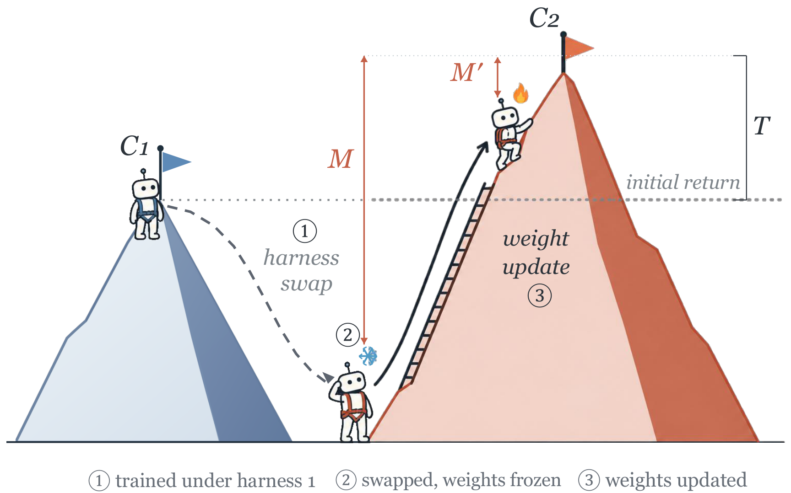

# Your Policy Is Secretly a Harness: The Decision Geometry of Agent Interfaces

Research code for the paper, including controlled MiniWoB++ experiments and a
five-harness coding-agent study on Terminal-Bench Lite.

Post-training moves a policy's action preferences toward its training harness's
optimum. Under KL-regularized control, **return = ceiling − mismatch** ($J=C-M$).
A harness revision can raise the ceiling while lowering a frozen model's return.
Adaptation reduces mismatch and can make the revised agent outperform the original.



*Figure 2. Harness changes can move both the ceiling and mismatch. Under the revised
harness, adaptation outperforms the initial agent once its mismatch falls below
the recovery threshold, $M'<T$.*

## Installation

Requires Python 3.12 and [uv](https://docs.astral.sh/uv/). Pi and DeepSeek Harness
also require Node.js 24 and Corepack.

```bash
uv sync --locked
(cd agents/pi && HUSKY=0 npm ci && npm run build:offline)
(cd agents/deepseek-harness && corepack pnpm install --frozen-lockfile && corepack pnpm run build:lib)
```

## Paper experiments

### MiniWoB++

Six harnesses on three task families support exact policy evaluation, oracle
ceilings, and Exact-PG training. Supply a local Qwen3.5-2B checkpoint:

```bash
bash scripts/setup_miniwob_training.sh
bash scripts/miniwob_harnesses.sh list
bash scripts/miniwob_harnesses.sh prepare --experiment environment/artifacts/v2/paper \
  --actor-model /path/to/Qwen3.5-2B --reference-model /path/to/Qwen3.5-2B \
  --reviewer-model /path/to/Qwen3.5-2B
bash scripts/miniwob_harnesses.sh train --experiment environment/artifacts/v2/paper \
  --harness H0 --output environment/artifacts/v2/paper/runs/exactpg_H0
```

Training uses Exact-PG with verl's worker and optimizer infrastructure.
See [environment/README.md](environment/README.md) for the paper experiment modules.

### Coding agents

Terminal-Bench Lite evaluates DeepAgents, Pi, DeepSeek Harness, Terminus-2, and
mini-SWE-agent with frozen Qwen3.5-9B and teacher-based ceiling/mismatch diagnostics.

Requires Linux, Docker, Git, `regctl` on `PATH`, NVIDIA GPUs, and a
vLLM 0.28.0+cu129 installation in `.venv-vllm`. Configure the teacher, inference
settings, and concurrency in
[`native_experiment.json`](src/benchmark/config/native_experiment.json).
Set `HRP_MODEL_DIR` to the target checkpoint and `HRP_API_KEY` for the teacher.
The launcher uses GPUs `0,1,2,3` by default. Set `HRP_GPU_IDS` to change them.

```bash
bash scripts/prepare_terminal_images.sh
bash scripts/eval_native_harnesses.sh results/accuracy
bash scripts/hrp_native_harnesses.sh results/hrp
```

## Code layout

- `src/hrp/`: estimator, scoring, and experiment contracts.
- `src/adapter/`: framework adapters and semantic action mappings.
- `src/benchmark/`: benchmark runners and configuration.
- `agents/`: vendored harness source.
- `environment/hrp_miniwob/`: environments, harnesses, training, and validation.
- `scripts/`: five main launchers and the Slurm worker used by GPU jobs.

MIT licensed. Vendored dependencies retain their original licenses.
See [THIRD_PARTY.md](THIRD_PARTY.md).
